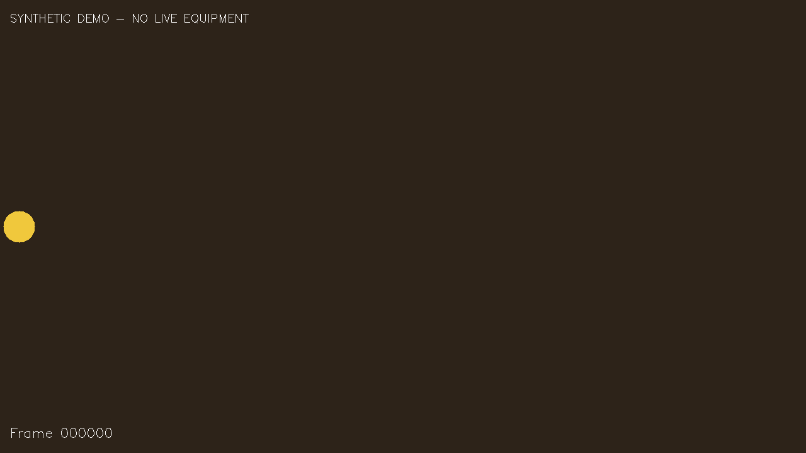
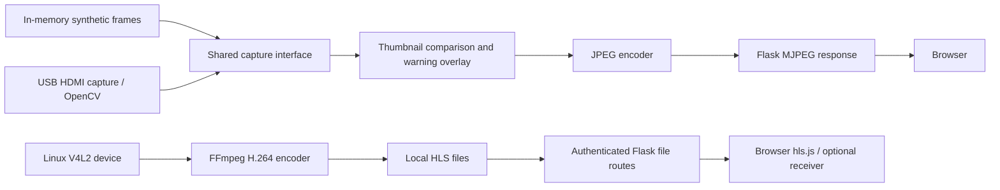

# HDMI Stream Monitor

A Python HDMI-to-browser streaming project for Raspberry Pi, with a safe synthetic demo that runs without capture hardware.



## Problem and scope

An HDMI display is often tied to a physical monitor. This application captures a USB HDMI input and makes its video available through a browser or an optional receiver. A simple freeze heuristic helps flag an image that has stopped changing.

The portfolio edition starts with generated frames, binds to the local computer only, and uses no real accounts or recordings. It does not send email or call external services. Installing packages requires internet access; running the default demo does not.

## What is implemented

- **MJPEG:** OpenCV captures and JPEG-encodes frames; Flask streams multipart HTTP responses. This is also the hardware-free demonstration path.
- **HLS:** an optional FFmpeg process captures a Linux V4L2 device and writes H.264 playlists and segments. A monitor thread attempts to restart an exited encoder. The browser uses a bundled hls.js player, with no CDN fallback.
- **Freeze indication:** MJPEG frames are resized to a 64 x 64 thumbnail. Normalized mean absolute pixel differences identify similar sampled frames; an elapsed-time threshold triggers a red warning overlay and status flag.
- **Access control:** optional bcrypt password hashes and Flask sessions, or a shared stream token for automated clients.
- **Diagnostics:** JSON status and health endpoints, active MJPEG connection counts, and optional rotating file logs.
- **Receiver:** a separate CLI launches VLC or ffplay for a supplied HLS URL and restarts the player after it exits. It runs only when explicitly invoked.

No hardware test, deployment, latency measurement, throughput result, or business outcome is claimed. See [verification evidence](docs/VERIFICATION.md).

## Architecture and engineering choices



MJPEG has a small dependency footprint and is easy to inspect, but each viewer encodes frames independently. HLS uses segmented video and a separate encoder process; it needs FFmpeg and compatible capture hardware. Freeze detection applies to MJPEG only because FFmpeg owns the HLS capture path. Environment variables keep local settings out of source control. The synthetic source implements the same small capture interface as OpenCV, so the demo exercises the actual JPEG streaming and diagnostics code.

The stack is Python, Flask/Werkzeug, OpenCV, NumPy, bcrypt and python-dotenv. HLS additionally uses FFmpeg and the bundled hls.js 1.5.15. The receiver needs VLC or ffplay. No GUI OpenCV package is needed.

## Install and run the demo

Use a standard 64-bit Python 3.11-3.14 installation. Windows with Python 3.14 was verified locally; other environments are CI targets until their checks run. Confirm that `python --version` launches your installed interpreter before continuing. If Windows opens the Store, select your installed Python executable or correct its PATH first.

In a terminal opened inside this repository:

**Windows PowerShell**

```powershell
python -m venv .venv
.\.venv\Scripts\python.exe -m pip install -r requirements.txt
.\.venv\Scripts\python.exe -B main.py --demo
```

**Linux / macOS**

```bash
python3 -m venv .venv
.venv/bin/python -m pip install -r requirements.txt
.venv/bin/python -B main.py --demo
```

Open **http://127.0.0.1:5000/**. You should see a moving circle, a frame counter, and `SYNTHETIC DEMO - NO LIVE EQUIPMENT`. Open **http://127.0.0.1:5000/status** and **http://127.0.0.1:5000/health** for diagnostics. Stop the server with **Ctrl+C**.

`python main.py` also defaults to the demo with no configuration. `--demo` explicitly forces synthetic MJPEG and loopback binding even if your local settings select hardware mode. It preserves other settings, including any authentication you have deliberately configured. No capture device, FFmpeg, receiver player, or external service is started by this command.

## Configuration

Optionally copy `.env.example` to `.env` **inside this repository**. Only that local `.env` is loaded; shell environment variables take precedence. The template is entirely fictional, and its secret fields are empty. It is not necessary to create this file for the demo.

| Setting | Default | Purpose |
| --- | --- | --- |
| `DEMO_MODE` | `true` | Use generated frames; `false` explicitly opts into equipment capture |
| `DEMO_FREEZE` | `false` | Generate a static image to exercise the warning |
| `SERVER_HOST` / `SERVER_PORT` | `127.0.0.1` / `5000` | Listen address and port |
| `STREAM_MODE` | `mjpeg` | `mjpeg` or hardware-only `hls` |
| `STREAM_WIDTH` / `STREAM_HEIGHT` | `1280` / `720` | Requested output dimensions |
| `TARGET_FPS` / `JPEG_QUALITY` | `5` / `80` | MJPEG pacing and JPEG quality |
| `ENABLE_FREEZE_DETECTION` | `true` | MJPEG heuristic enabled |
| `FREEZE_CHECK_INTERVAL` | `5` | Sample every N frames |
| `FREEZE_THRESHOLD` / `FREEZE_ALERT_SECONDS` | `0.995` / `2` | Similarity threshold and elapsed similar-image interval |
| `STREAM_TOKEN` / `SECRET_KEY` | empty | Optional shared token and persistent session signing key |
| `USERS_FILE` | `users.json` | Local username to bcrypt-hash mapping; never committed |
| `PROTECT_INDEX` / `PROTECT_HEALTH` | `true` / `false` | Apply configured authentication to viewer / health routes |
| `LOG_TO_FILE` | `false` | Opt into local rotating logs |

For a freeze demo, set `DEMO_FREEZE=true` in `.env`, restart, and open the viewer. At the default sampling rate, the overlay appears after several seconds; sampling and the first reference frame add delay beyond the configured alert interval. `/status` then reports `stream_frozen: true`. Set it back to `false` and restart to restore motion.

For a local login demonstration, run `.\.venv\Scripts\python.exe -B main.py --add-user` on Windows (or `.venv/bin/python -B main.py --add-user` on Linux). Choose your own local username and password. Restart the demo and log in through the viewer. `--list-users` and `--remove-user` manage that local file. Passwords are stored as bcrypt hashes; no example accounts are shipped. A random session key is generated on startup unless you set `SECRET_KEY` locally. Generate values with `python -c "import secrets; print(secrets.token_hex(32))"`; keep them in your ignored `.env`.

Authentication is disabled when both the user mapping and stream token are empty. Removing the last user therefore disables user-based protection. Malformed existing user files fail closed instead of silently disabling authentication. `/health` is public unless `PROTECT_HEALTH=true`.

For capture-card settings, HLS, encoders and the receiver, see [the optional hardware guide](docs/HARDWARE.md). Those paths require explicit configuration and were not tested with equipment.

## HTTP interface

| Endpoint | Behavior |
| --- | --- |
| `/` | Viewer; redirects to login when configured |
| `/login`, `/logout` | Session login and logout |
| `/video_feed` | MJPEG multipart stream; 404 in HLS mode |
| `/hls/<filename>` | HLS playlist or segment; 404 in MJPEG mode |
| `/hls_t/<token>/<filename>` | Token-path HLS route for players resolving relative segment URLs |
| `/status` | Source type, capture state, frame count, freeze state and mode-specific fields |
| `/health` | 200 when source/stream checks pass, otherwise 503; 401 when protected |

Protected routes accept `X-Auth-Token` or `Authorization: Bearer ...`; the viewer also supports a token query parameter and an HttpOnly token cookie. URL tokens can appear in browser history and server access logs. Use session login for the local browser demo, and do not expose this development server to the internet.

## Checks

On Windows:

```powershell
.\.venv\Scripts\python.exe -B -m unittest discover -s tests -v
.\.venv\Scripts\python.exe -B tools/check_publication.py
.\.venv\Scripts\python.exe -B tools/check_syntax.py
.\.venv\Scripts\python.exe -m pip check
```

On Linux/macOS replace `.\.venv\Scripts\python.exe` with `.venv/bin/python`. Tests decode a generated JPEG, exercise the real Flask routes, verify access control regressions, and check freeze timing and recovery. Encoder/player interactions are mocked where needed. CI runs the same checks on Windows and Linux with Python 3.11 and 3.14; no CI run is claimed until GitHub executes it.

## Limitations and future improvements

- This is a small single-process Flask application with global capture/state locks. Multiple MJPEG viewers share capture but each performs encoding and freeze sampling; frame counters are sampling work, not a unique-source-frame metric. A shared producer with cached frames would improve that design.
- A static legitimate screen can trigger the freeze warning; small changes, capture noise or low contrast can hide a freeze. It is an image-change heuristic, not equipment fault detection. There is no HLS freeze analysis.
- MJPEG health reports whether the capture interface is open, not when a frame was last successfully delivered. HLS health checks a running process and local playlist/segment presence and freshness, not successful playback.
- HLS restarts and capture reconnection are best-effort. Encoder compatibility, capture negotiation, browser playback, LAN behavior and Raspberry Pi performance require hardware validation. HLS segment cleanup/startup under concurrent requests needs further testing.
- The included Flask server is for demonstration. TLS, login rate limiting, CSRF protection, hardened session/cookie policy and service supervision would be needed before wider deployment. Token URLs are a compatibility option with disclosure risks.
- Numeric settings are parsed at import; invalid nonnumeric values can stop startup. Bcrypt has a 72-byte password limit. Dependency ranges are not a reproducible lockfile, and no dependency vulnerability audit is claimed.
- Useful next work: a single capture producer, frame-age health checks, integration tests with a synthetic FFmpeg source, pinned dependency updates, and a documented hardware test matrix.

## Publication and reuse

This folder was prepared separately from the original workspace, without its Git history, user accounts, operational data or generated workplace documents. Read [the publication review](docs/PUBLICATION_REVIEW.md) before uploading. An automated scan cannot establish ownership or permission to publish. No project licence or copyright claim has been added. Third-party hls.js notices are preserved separately in [THIRD_PARTY_NOTICES.md](THIRD_PARTY_NOTICES.md).

[GitHub upload instructions](docs/GITHUB_UPLOAD.md) · [Repository metadata and CV wording](docs/PORTFOLIO.md) · [Verification record](docs/VERIFICATION.md)
